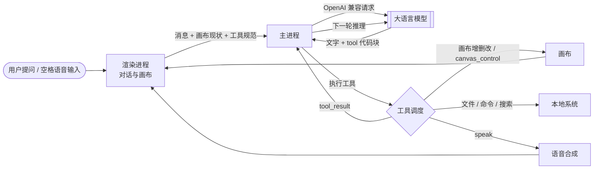

<div align="center">

# 🎨 LearnCanvas

**用户只负责提问，AI 负责把知识「画」出来、讲出来。**

一款把画布控制权完全交给 AI 的桌面学习应用

<br />


[](https://github.com/zhj-ldm/learncanvas/releases/latest)
[](https://github.com/zhj-ldm/learncanvas/releases)
[](https://github.com/zhj-ldm/learncanvas/stargazers)


<br />

[下载安装](#-快速开始) · [功能特性](#-功能特性) · [工作原理](#-工作原理) · [技术栈](#-技术栈) · [常见问题](#-常见问题)

</div>

---

## 📖 这是什么

LearnCanvas 是一款基于 Electron 的桌面 AI 学习应用。它把「画布」的完全控制权交给 AI：模型在讲解的同时，实时在画布上生成公式、图表、示意图与**可交互的教学组件**，并通过语音把内容讲出来——像一位会板书、会演示、还能对话的老师。

传统 AI 学习工具大多停留在「聊天框 + 富文本」：模型能说，却不会画；能答，却不能一步演给你看。LearnCanvas 换了个思路——**把画布做成模型的一等公民工具**。模型像老师用黑板一样，按讲解节奏增删改画布内容，并逐步驱动演示组件，形成「用户问一句、演示走一步」的沉浸式学习体验。

> 💡 一句话总结：**别的 AI 在聊天，LearnCanvas 在给你上课。**

---

## ✨ 功能特性

### 🖌️ AI 掌舵的画布

画布不是被动展示区，而是 AI 可以直接操作的工作台。模型通过结构化指令完成增删改，支持五种块类型：

| 块类型 | 能力 | 典型用途 |
| :--- | :--- | :--- |
| `markdown` | 富文本、表格、任务列表、代码块 | 概念讲解、例题、笔记 |
| `markdown` + LaTeX | `$...$` / `$$...$$` 实时渲染 | 数学、物理公式推导 |
| `mermaid` | 流程图、时序图、思维导图 | 知识结构、算法流程 |
| `svg` | 内联矢量绘图，自适应宽度 | 几何图形、坐标图、示意图 |
| `html` | 自包含可交互组件（滑块 / 按钮 / Canvas 动画） | 分步实验、模拟演示 |
| `image` | 图片 URL 或 data URI | 配图、素材 |

画布操作指令：

```jsonc
{"op": "add",     "kind": "markdown", "title": "标题", "content": "整块源码"}
{"op": "patch",   "id": "b3", "content": "替换后的整块源码", "title": "新标题"}
{"op": "replace", "id": "b3", "kind": "svg", "content": "..."}
{"op": "remove",  "id": "b3"}
{"op": "focus",   "id": "b4"}   // 滚动定位到该块
{"op": "clear"}                 // 仅在用户明确要求时使用
```

### 🎮 可操控的交互教学

AI 生成的 HTML 组件遵循统一的控制协议：组件监听 `lc:command`，执行动作并把状态回报给宿主。于是模型可以**分多轮**推进一个演示——先建组件，再一步步调节，边调边讲。

```js
// 组件侧：接收 AI 指令并回报状态
window.addEventListener('message', (e) => {
  const m = e.data || {};
  if (m.type !== 'lc:command') return;
  applyCommand(m.action, m.value);          // 如 "progress" / "step" / "set" / "play" / "reset"
  parent.postMessage({
    type: 'lc:result',
    ok: true,
    data: { action: m.action, state: '当前状态摘要' }
  }, '*');
});
```

模型侧只需调用：

```jsonc
{"name": "canvas_control", "input": {"block_id": "b1", "action": "step", "value": 3}}
```

这让「讲解」和「演示」真正同步：用户每问一句，画面就往前走一步。

### 🎙️ 全离线语音

内置 sherpa-onnx 语音识别（Paraformer 中文 int8 模型），按住空格即可说话；朗读侧提供多引擎自动降级：

| 引擎 | 类型 | 特点 | 是否需联网 |
| :--- | :--- | :--- | :---: |
| **Edge TTS** | 在线 | 最自然、响应最快（默认） | ✅ |
| **Kokoro int8** | 本地 | 8 个中文音色，离线可用 | ❌ |
| **Melo TTS** | 本地 | 中英混合，离线可用 | ❌ |
| **系统语音** | 本地 | macOS `say` 兜底，零依赖 | ❌ |

- **语音输入 / 语音朗读独立开关**：可以只听不说、只说只听，也可同时开启。
- 开启朗读后，AI 每轮必须调用一次 `speak` 工具，否则本轮视为未完成并被强制重来——保证「画到哪、讲到哪」。
- 长文本自动按句切块、预取下一句合成，句间几乎无空档；关闭朗读会立即中断播放并清空队列。

### 🧰 不止会讲，还会做

模型拥有一整套本地工具，可以真的去读文档、跑代码、查资料：

| 工具 | 作用 |
| :--- | :--- |
| `read_file` / `write_file` / `edit_file` | 读写与精确编辑本地文件 |
| `list_dir` / `glob` / `grep` | 浏览目录、按名/按内容检索 |
| `move_file` / `delete_file` | 移动、删除文件 |
| `run_command` | 执行本地命令（带超时） |
| `web_search` / `web_fetch` | 多引擎联网搜索、抓取网页正文 |
| `canvas_control` | 向画布交互组件下发指令 |
| `speak` | 朗读一段内容 |

工具调用统一写成 ```` ```tool ```` 围栏中的 JSON，系统执行后把结果回灌给模型继续推理。

### 🔌 开放模型

兼容任意 OpenAI 协议的 Chat Completions 接口，模型、成本、数据都由你自己掌握（DeepSeek、OpenAI 及各类自建网关均可）。

---

## 🚀 快速开始

### 环境要求

- **macOS 12+（Apple Silicon）**
- Node.js **≥ 18**（开发运行需要）

### 安装

从 [Releases](https://github.com/zhj-ldm/learncanvas/releases/latest) 下载 `LearnCanvas-0.1.0-arm64.dmg`：

1. 双击挂载 DMG，把 **LearnCanvas** 拖入「应用程序」
2. 首次打开若提示「无法验证开发者」，右键 →「打开」，或执行：

```bash
xattr -cr /Applications/LearnCanvas.app
```

### 从源码运行

```bash
git clone https://github.com/zhj-ldm/learncanvas.git
cd learncanvas
npm install
npm start
```

### 首次配置

打开「设置」，填写模型服务：

| 配置项 | 说明 | 示例 |
| :--- | :--- | :--- |
| 接口地址 | OpenAI 兼容 Base URL | `https://api.deepseek.com/v1` |
| API Key | 对应服务的密钥 | `sk-...` |
| 模型 | 模型名称 | `deepseek-chat` |

语音功能会自动检测本地模型，缺失时可在设置中一键下载（约 180–350 MB，存放于用户数据目录 `models/`）。

---

## ⚙️ 工作原理



1. **组上下文**：把系统提示、画布现状（块 ID / 类型 / 行数）与工具规范一起发给模型。
2. **模型思考**：模型输出自然语言 + ```` ```tool ```` 代码块形式的工具调用。
3. **执行工具**：主进程 / 渲染进程执行工具，结果以 `<tool_result>` 回灌。
4. **循环推进**：模型继续下一轮，直到本轮目标完成。
5. **画面与朗读**：画布按指令更新，`speak` 进入播放队列，语音与画面同步。

> 为保证「边画边讲」，系统提示对风格做了约束：对话区只写 1–4 句短句，长篇内容进画布；数学必须用 LaTeX；每轮至少产出一个画布操作（闲聊除外）。

---

## 🧱 技术栈

| 层 | 选型 | 说明 |
| :--- | :--- | :--- |
| 桌面容器 | **Electron 33** | 主进程 + 渲染进程 + `contextBridge` 安全桥 |
| 渲染层 | **原生 JavaScript** | 无前端框架，零构建，启动快 |
| 内容渲染 | **marked · KaTeX · Mermaid** | Markdown / LaTeX / 图表一站式渲染 |
| 交互组件 | **iframe + postMessage** | 隔离执行 AI 生成的 HTML，双端指令协议 |
| 语音识别 | **sherpa-onnx**（Paraformer int8） | 本地离线中文识别 |
| 语音合成 | **Edge TTS / Kokoro / MeloTTS / `say`** | 在线优先，本地多级兜底 |
| 模型接入 | **OpenAI 兼容 API** | 自定义 Base URL / Key / Model |
| 语音进程 | **独立 Node 子进程 + IPC** | 规避 Electron 原生 buffer 限制，不阻塞主进程 |

---

## 📂 项目结构

```text
learncanvas/
├── main.js               # 主进程：窗口、模型请求、文件工具、IPC
├── preload.js            # contextBridge 安全桥
├── voice.js              # 语音服务：模型下载、ASR 推理、TTS 调度与兜底
├── voice-tts-server.js   # TTS 独立子进程（sherpa-onnx 本地合成）
├── edge-drm.js           # Edge TTS 鉴权 token 生成
├── bin/
│   └── aggrsearch        # 联网搜索聚合工具
├── renderer/
│   ├── index.html        # 界面结构
│   ├── app.js            # 对话、工具解析、语音播放、设置
│   ├── canvas.js         # 画布视图：块渲染、iframe 交互、指令转发
│   └── styles.css        # 样式
└── package.json
```

---

## 🛠️ 开发与构建

```bash
npm start          # 开发运行
```

打包 macOS 应用：

```bash
npx electron-packager . LearnCanvas --platform=darwin --arch=arm64 --out=dist
```

> 语音模型不随应用分发，首次使用按需下载到 `~/Library/Application Support/LearnCanvas/models`。

---

## ❓ 常见问题

<details>
<summary><b>打开时提示「无法验证开发者」怎么办？</b></summary>

应用未经过 Apple 公证。右键点击应用 →「打开」，或执行：

```bash
xattr -cr /Applications/LearnCanvas.app
```

</details>

<details>
<summary><b>语音没声音 / 不朗读？</b></summary>

1. 检查顶栏喇叭按钮是否点亮（语音朗读开关）。
2. 在「设置 → 语音」确认引擎；Edge 需要联网，本地引擎需要先下载模型。
3. 若本地模型损坏，删除 `models/` 目录后重新下载。

</details>

<details>
<summary><b>按住空格没反应？</b></summary>

顶栏麦克风按钮需处于开启状态，且首次使用时系统会请求麦克风权限。

</details>

<details>
<summary><b>可以用哪些模型？</b></summary>

任何 OpenAI 兼容的 Chat Completions 服务。为了工具调用稳定，建议选择指令遵循能力较强的模型。

</details>

<details>
<summary><b>AI 生成的教学组件安全吗？</b></summary>

HTML 组件运行在受限 `iframe` 中，通过 `postMessage` 与宿主通信；CSP 禁止外部脚本，组件必须是自包含代码。

</details>

---

## 🤝 贡献

欢迎提交 Issue 与 Pull Request。提交前请确保：

- 能正常运行 `npm start`
- 不引入外部 CDN 依赖
- 保持「无构建、原生实现」的轻量风格

## 📄 License

[Apache-2.0](LICENSE) © zhj-ldm
